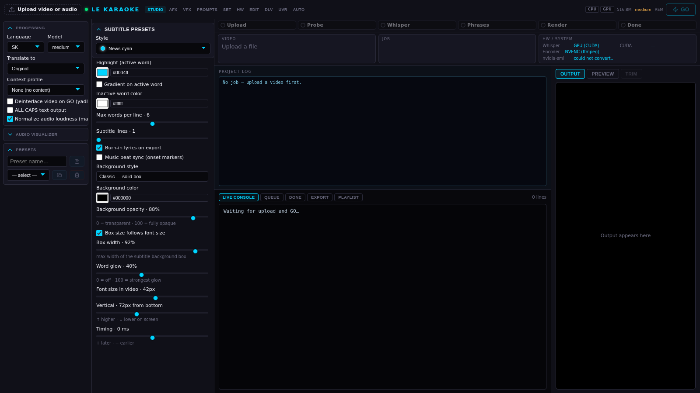

# LE Karaoke Studio

Turning source audio or video into a finished karaoke or captioned clip often means moving between download, transcription, editing and export tools. LE Karaoke Studio brings those stages into one workspace, with a hands-on studio and an automation area for repeatable media work.

## Tech stack

| Layer | Technologies |
|---|---|
| Application | Python, FastAPI |
| Supporting technologies | React, TypeScript; Whisper, PyTorch; FFmpeg, Remotion, HyperFrames; yt-dlp |

## Prepare and transcribe media

Upload a clip or work through a batch, review its format and choose the part that should be processed. Transcription provides a starting point for timed text, while phrase editing helps turn that output into readable lines. Translation and speaker-related options support the cases that need them.

## Shape subtitles and visualisers

Choose subtitle styling, line presentation and visualiser options to build a consistent look across clips. Saved presets reduce repeated setup when several videos should share the same style. Preview-oriented work helps refine the result before committing to a longer export.

## Audio and visual effects workspaces

The audio-effects and visual-effects areas let the operator experiment with the presentation around the clip. Playlist and beat-related controls support musical timing, while overlay choices cover subtle effects through more elaborate styles. Assistance tools can suggest options without replacing the operator's final choice.

## Download and separate stems

The downloader brings source acquisition into the workspace, with progress and history for ongoing work. Stem separation provides another preparation step when vocals or accompaniment need independent attention. Keeping these tasks nearby reduces tool switching before the main studio work begins.

## Review, render and export

Follow job progress, inspect results and download the finished video. Editing, trim and output options support different source material and export needs. Batch handling and reusable presets make repeated production more manageable than setting up every clip from scratch.

## Automate repeatable production

The automation area brings source selection, categorisation, review and distribution into a managed workflow. Test Lab approval and rejection allow human review before moving forward, while queues and history help follow what happened. Configured publication workflows support X, Telegram and Rumble. Model comparisons, context prompts, settings and hardware visibility support refining that workflow over time.

---

Private code: [le-karaoke-studio](https://github.com/logicencoder/le-karaoke-studio)

See [REPOS.md](REPOS.md) for related repositories.

**[Logic Encoder](https://logicencoder.com)** · [GitHub](https://github.com/logicencoder) · [Contact](https://logicencoder.com/contact/)
